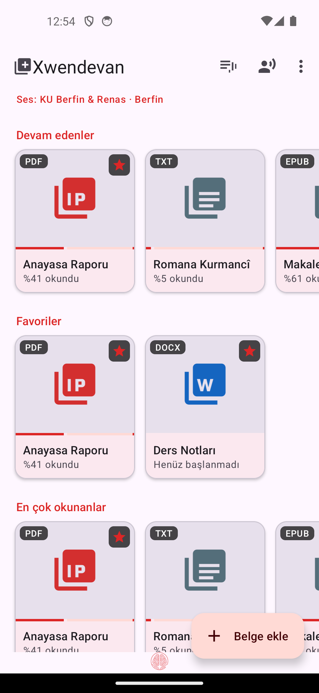
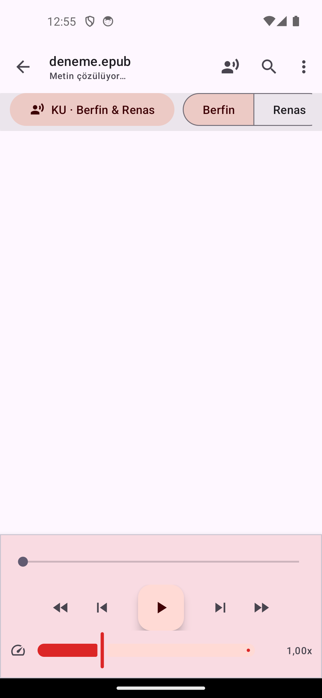
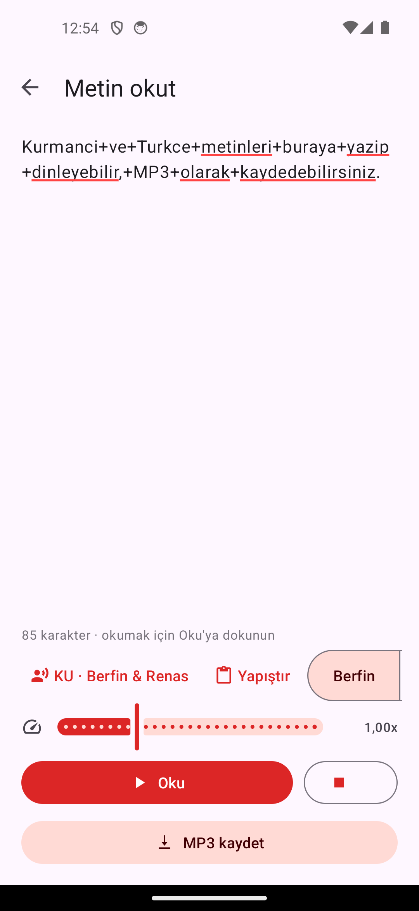

<div align="center">


# Xwendevan

**Reads your documents aloud — fully offline**

PDF · DOCX · EPUB · TXT · your own text
Kurmanji · Turkish · English · Arabic

A [**Cybergah**](https://cybergah.com/) project · [Türkçe](README.md)

[](https://github.com/cybergah8-lang/xwendevan/releases/latest)
[](LICENSE)
[](#install)

</div>

---

## What it does

Xwendevan reads the documents on your phone aloud, **completely offline**. The
voice models ship inside the app: no downloads, no account, no internet.

| | |
|---|---|
| **Kurmanji voice** | Berfin and Renas — two speakers in one model |
| **Turkish voices** | Yelda · Fahrettin · Murat |
| **Documents** | PDF (page layout preserved), DOCX, EPUB, TXT |
| **Read text** | Reads text you type and saves it as **MP3** |
| **Scanned PDFs** | On-device **OCR** (Turkish + Kurmanji) |
| **System engine** | Can be selected as the phone's text-to-speech engine |

<div align="center">



</div>

## Why

There was no free, offline audio reader for Kurmanji that runs on a phone.
For blind and low-vision users, people with dyslexia, and anyone who wants to
finish long texts by listening, a single APK is all it takes.

Xwendevan can also be set as the system **text-to-speech engine**. The
Kurmanji voice then works in TalkBack, the browser and every other app. Android
has no other Kurdish option.

## Install

Download the APK for your phone from the
[**Releases**](https://github.com/cybergah8-lang/xwendevan/releases/latest) page:

| File | For |
|---|---|
| `Xwendevan-…-arm64-v8a.apk` | **Default choice**: almost any phone made after 2016 |
| `Xwendevan-…-armeabi-v7a.apk` | Very old / 32-bit phones |

Open the APK and allow installs from unknown sources. Over USB:

```bash
adb install -r Xwendevan-1.5-arm64-v8a.apk
```

> The APKs are ~320 MB because four voice models and the OCR data are bundled.
> Nothing is downloaded afterwards.

**Requires:** Android 7.0 (API 24) or newer · ~700 MB free space

## Highlights

- **PDF as-is**: layout, fonts and images stay intact, and the sentence being
  read is highlighted on the page.
- **Triple tap**: tap a spot three times and reading continues from there.
- **Sleep timer**: 15/30/45/60 min, "end of paragraph", "end of document".
- **Bookmarks and search**: mark a sentence, search the document, tap a result.
- **Document to MP3**: one file, or 15/30-minute parts.
- **Pronunciation dictionary**: "TBMM → Te Be Em Me" without changing the document.
- **Language detection**: switches to the Kurmanji voice automatically for Kurmanji documents.
- **Listening stats**: today / this week / total, last seven days.
- **Reads with the screen off**: notification, lock screen and headset buttons.

Details (Turkish): [OKUMA-BENI.md](OKUMA-BENI.md)

## Privacy

The app never goes online. Your documents, the text you type and the audio you
generate never leave the device. No ads, no tracking, no accounts. The only
permissions requested are notifications (playback controls) and, on Android 9
and older, writing MP3 files to Downloads.

## Build from source

```bash
git clone https://github.com/cybergah/xwendevan.git
cd xwendevan
./gradlew :app:assembleRelease
```

- Android SDK 34 · JDK 17 · minSdk 24 · AGP 8.5.2
- Output: `app/build/outputs/apk/release/`
- Signing: uses `keystore.properties` if present, otherwise the debug key
  ([`keystore.properties.example`](keystore.properties.example))

The repository contains the voice models (255 MB) and OCR data, so the clone is large.

### Components

| Component | License |
|---|---|
| [sherpa-onnx](https://github.com/k2-fsa/sherpa-onnx) · ONNX Runtime | Apache-2.0 · MIT |
| [espeak-ng](https://github.com/espeak-ng/espeak-ng) | GPL-3.0 |
| [Piper](https://github.com/OHF-Voice/piper1) (VITS) voice models | MIT (model licenses below) |
| [PDFBox Android](https://github.com/TomRoush/PdfBox-Android) | Apache-2.0 |
| [jump3r](https://github.com/Sciss/jump3r) (LAME) for MP3 | LGPL-2.1 |
| [Tesseract4Android](https://github.com/adaptech-cz/Tesseract4Android) for OCR | Apache-2.0 |

## License

Xwendevan is free software. Because espeak-ng is GPL-3.0, the whole app is
distributed under **GPL-3.0 or later**. See [LICENSE](LICENSE).

The voice models are licensed separately:

| Voice | License | Source |
|---|---|---|
| Kurmanji · Berfin & Renas | CC BY-NC 4.0 | [rojanu/piper-ku-berfin-renas-medium](https://huggingface.co/rojanu/piper-ku-berfin-renas-medium) |
| Turkish · Murat | CC BY-NC-SA 4.0 (dfki dataset) | [rhasspy/piper-voices](https://huggingface.co/rhasspy/piper-voices) |
| Turkish · Yelda, Fahrettin | Piper community models | no license stated on the model cards |

Because of the **NC (non-commercial)** terms, the app and the audio it produces
may not be sold. Education, accessibility and personal use are free.

## Contributing

The Kurmanji voice model was trained on only 2.7 hours of audio, so more
recordings would improve it noticeably. Voice recordings, translation fixes,
bug reports and code are all welcome:
[open an issue](https://github.com/cybergah/xwendevan/issues).

---

<div align="center">

**Cybergah** — *Your freedom HQ in digital chaos*

[cybergah.com](https://cybergah.com/)

</div>
