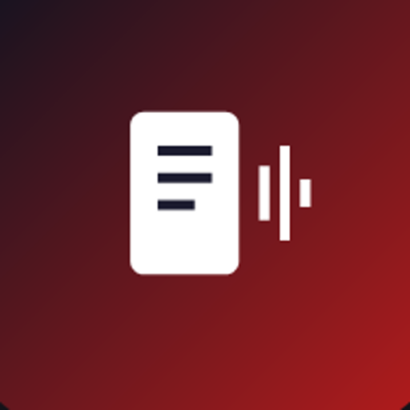
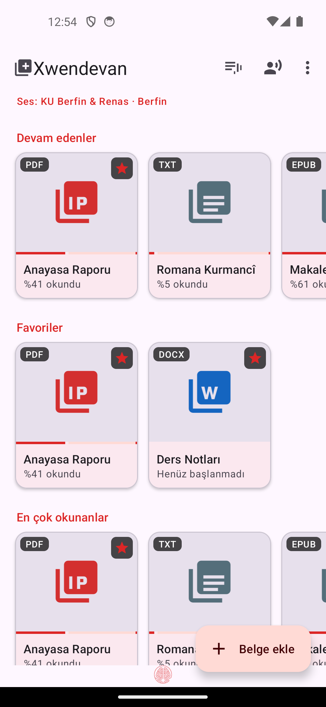
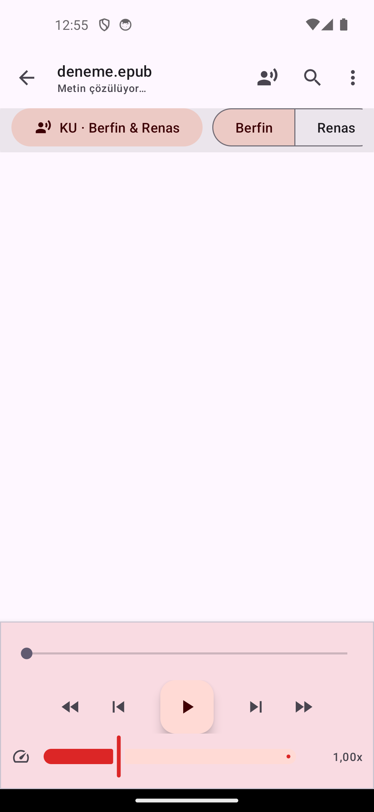
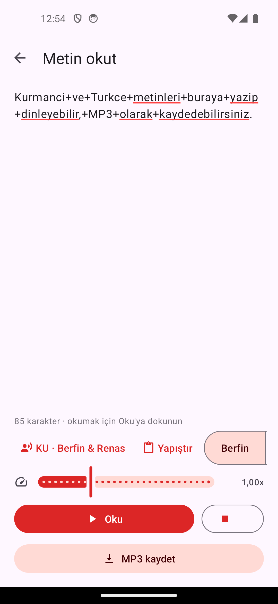

<div align="center">



# Xwendevan

**belgeleri sesli okur** · *belgeyan bi deng dixwîne* · *reads documents aloud*

PDF · DOCX · EPUB · TXT · yazdığınız metin
Kurmancî · Türkçe · English · العربية

Bir [**Cybergah**](https://cybergah.com/tr/) çalışması

[](https://github.com/cybergah8-lang/xwendevan/releases/latest)
[](LICENSE)
[](#kurulum)

</div>

<p align="center"><a href="README.en.md"><b>🇬🇧 Read in English</b></a></p>

---

## Ne yapar

Telefondaki belgeleri **tamamen çevrimdışı** seslendirir. Ses modelleri
uygulamanın içinde gelir: indirme yok, hesap yok, internet yok.

| | |
|---|---|
| **Kurmancî ses** | Berfin ve Renas — tek modelde iki konuşmacı |
| **Türkçe ses** | Yelda · Fahrettin · Murat |
| **Belgeler** | PDF (sayfa görüntüsü bozulmadan), DOCX, EPUB, TXT |
| **Metin okut** | Yazdığınız metni okur, **MP3** olarak kaydeder |
| **Taranmış PDF** | Cihazda **OCR** (Türkçe + Kurmancî) |
| **Sistem motoru** | Telefonun konuşma motoru olarak seçilebilir |

<div align="center">



</div>

## Neden

Kurmancî için telefonda çalışan, ücretsiz ve çevrimdışı bir sesli okuyucu yoktu.
Görme engelli kullanıcılar, disleksisi olanlar ve uzun metinleri dinleyerek
bitirmek isteyenler için tek gereken bir APK.

Uygulama sistemin **konuşma motoru** olarak da seçilebilir: o zaman Kurmancî ses
TalkBack'te, tarayıcıda ve bütün uygulamalarda çalışır — Kürtçe için sistemde
başka seçenek yok.

## Kurulum

[**Releases**](https://github.com/cybergah8-lang/xwendevan/releases/latest)
sayfasından telefonunuza uygun APK'yı indirin:

| Dosya | Kimin için |
|---|---|
| `Xwendevan-…-arm64-v8a.apk` | **Normal seçim** — 2016 sonrası tüm telefonlar |
| `Xwendevan-…-armeabi-v7a.apk` | Çok eski / 32-bit telefonlar |

APK'yı açın, "bilinmeyen kaynak" uyarısında izin verin. Kabloyla:

```bash
adb install -r Xwendevan-1.5-arm64-v8a.apk
```

> APK'lar ~320 MB: dört ses modeli ve OCR verisi içeridedir. Sonrasında
> hiçbir şey indirilmez.

**Gereken:** Android 7.0 (API 24) ve üzeri · ~700 MB boş alan

## Öne çıkanlar

- **PDF olduğu gibi** — sayfa düzeni, yazı tipleri, görseller bozulmaz; okunan
  cümle sayfanın üzerinde işaretlenir.
- **Üç kez dokun** — belgede bir yere üç kez dokunun, okuma oradan sürer.
- **Uyku zamanlayıcısı** — 15/30/45/60 dk, "paragraf bitince", "belge bitince".
- **Yer imi ve arama** — cümleyi işaretle, belgede ara, sonuca dokun.
- **Belgeyi MP3 yap** — tek dosya ya da 15/30 dakikalık parçalar.
- **Telaffuz sözlüğü** — "TBMM → Te Be Em Me"; belge metni değişmez.
- **Dil algılama** — belge Kurmancî ise Kurmancî sese kendiliğinden geçer.
- **Dinleme istatistiği** — bugün / bu hafta / toplam, son yedi gün.
- **Ekran kapalıyken okur** — bildirim, kilit ekranı, kulaklık düğmeleri.

Ayrıntılar: [OKUMA-BENI.md](OKUMA-BENI.md)

## Gizlilik

Uygulama internete çıkmaz. Belgeleriniz, yazdığınız metin ve ürettiğiniz ses
cihazdan dışarı gitmez; reklam, izleme ve hesap yoktur. İstenen izinler yalnızca
bildirim (okuma denetimi) ve Android 9 ve öncesinde MP3'ü İndirilenler'e
yazmaktır.

## Kaynaktan derleme

```bash
git clone https://github.com/cybergah8-lang/xwendevan.git
cd xwendevan
./gradlew :app:assembleRelease
```

- Android SDK 34 · JDK 17 · minSdk 24 · AGP 8.5.2
- Çıktı: `app/build/outputs/apk/release/`
- İmza: `keystore.properties` varsa onunla, yoksa hata ayıklama anahtarıyla
  imzalanır ([`keystore.properties.example`](keystore.properties.example))

Depo, ses modellerini (255 MB) ve OCR verisini içerir; klonlama bu yüzden büyük.

### Kullanılan bileşenler

| Bileşen | Lisans |
|---|---|
| [sherpa-onnx](https://github.com/k2-fsa/sherpa-onnx) · ONNX Runtime | Apache-2.0 · MIT |
| [espeak-ng](https://github.com/espeak-ng/espeak-ng) | GPL-3.0 |
| [Piper](https://github.com/OHF-Voice/piper1) (VITS) ses modelleri | MIT (model lisansları aşağıda) |
| [PDFBox Android](https://github.com/TomRoush/PdfBox-Android) | Apache-2.0 |
| [jump3r](https://github.com/Sciss/jump3r) (LAME) — MP3 | LGPL-2.1 |
| [Tesseract4Android](https://github.com/adaptech-cz/Tesseract4Android) — OCR | Apache-2.0 |

## Lisans

Xwendevan özgür yazılımdır. espeak-ng bileşeni GPL-3.0 olduğu için uygulamanın
tamamı **GPL-3.0 veya sonrası** koşullarıyla dağıtılır — bkz. [LICENSE](LICENSE).

Ses modelleri ayrı lisanslıdır:

| Ses | Lisans | Kaynak |
|---|---|---|
| Kurmancî · Berfin & Renas | CC BY-NC 4.0 | [rojanu/piper-ku-berfin-renas-medium](https://huggingface.co/rojanu/piper-ku-berfin-renas-medium) |
| Türkçe · Murat | CC BY-NC-SA 4.0 (dfki veri kümesi) | [rhasspy/piper-voices](https://huggingface.co/rhasspy/piper-voices) |
| Türkçe · Yelda, Fahrettin | Piper topluluk modelleri | model kartlarında lisans belirtilmemiş |

**NC (ticari olmayan)** koşulu nedeniyle bu uygulama ve ürettiği ses dosyaları
satılamaz; eğitim, erişilebilirlik ve kişisel kullanım serbesttir.

## Katkı

Kurmancî ses modelinin verisi yalnızca 2,7 saat — daha fazla kayıtla model
belirgin biçimde iyileşir. Ses kaydı, çeviri düzeltmesi, hata bildirimi ve kod
katkısı için [issue açın](https://github.com/cybergah8-lang/xwendevan/issues).

---

<div align="center">

**Cybergah** — *Dijital karmaşada özgürlük karargahınız*

[cybergah.com/tr](https://cybergah.com/tr/) · [cybergah.com/ku](https://cybergah.com/ku/)

</div>
